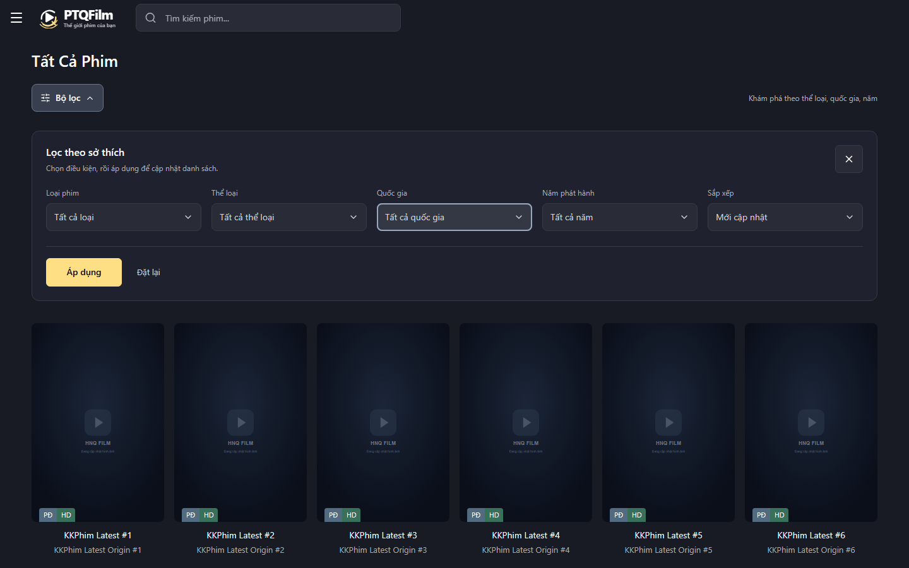
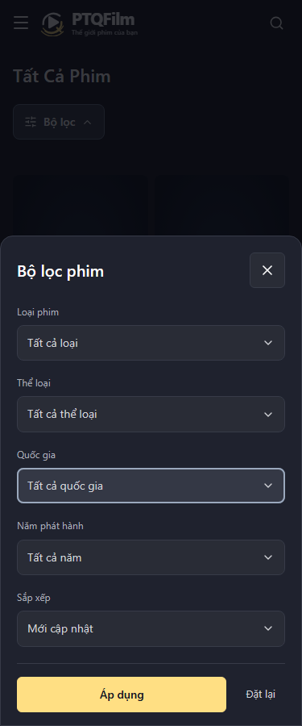
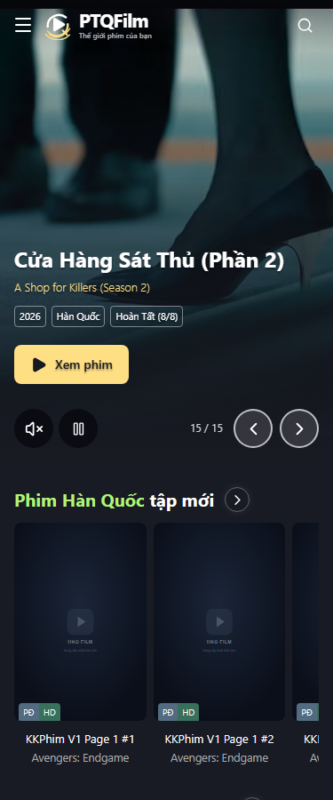
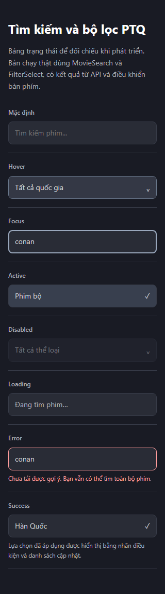
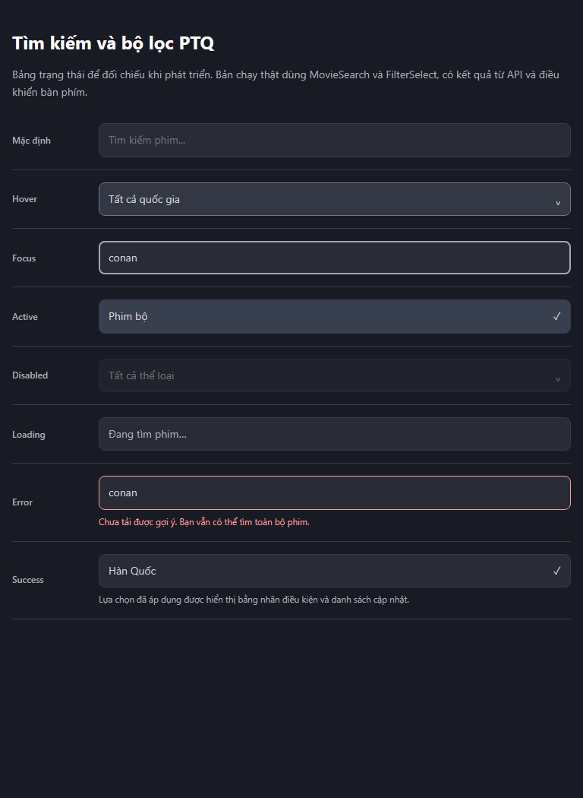

<!-- Hallmark · component-scope · design-system: design.md · pre-emit critique: P5 H4 E4 S5 R5 V4 -->

# PTQ — kết quả triển khai chỉnh sửa giao diện

Hoàn thành ngày 17/10/2026, theo [báo cáo và phương án đã chọn](REPORT.md). Giữ hệ thống poster, đường dẫn và nguồn phim; sửa các component hiện có, thêm MovieSearch/FilterSelect dùng chung. Không thêm thư viện UI.

## Kết quả

| Hạng mục audit | Thay đổi | Bằng chứng |
| --- | --- | --- |
| F01, F08 | Focus xám xanh 2px nằm trong trường; header 56/60px chứa control 44px; input và popup chung hai mép. | Đo trên local: cả hai rộng 420px tại viewport 1017px; kiểm thử tự động đối chiếu hai mép và màu/offset focus. |
| F03, F09–F11 | MovieSearch dùng chung trên header, dialog mobile và form trang kết quả; xóa xong trả focus; poster 44×66, tên Việt/tên gốc/năm phân cấp; ↑/↓/Enter/Escape và cuộn nội bộ theo lựa chọn. | Test desktop/mobile, hydration chậm, lỗi/retry, không kết quả và request cũ trả trễ. Đã xem trực tiếp gợi ý Conan trên local bằng dữ liệu thật. |
| F02, F04, F12 | Menu lọc nền tối thay select native; tìm nhanh không dấu, dấu check lựa chọn, chip điều kiện đã áp dụng; sheet mobile với nội dung cuộn/footer cố định; trạng thái tải nằm ngoài panel. | Kiểm thử 320/375/414/768/800/1024/1280/1440/1920px, phím chọn, nháp/hủy/đặt lại/áp dụng, pending, xóa chip, Back và giữ mặc định route. |
| F05, F06 | Giữ nút Xem phim trên tablet/mobile; chấm nhỏ được thay bằng trước/sau, vị trí hiện tại và vuốt; vùng chạm 44px. Desktop giữ các lựa chọn trực tiếp. | Cả 15 video phát khi chọn trên 375px và 1440px; kiểm tra mute/pause/reduced motion/fallback ảnh; kiểm thử nút và thao tác vuốt. |
| F13 | CTA Xem Ngay chiếm một hàng trên mobile; hàng dưới chia đều các thao tác phụ. | Kiểm thử CTA một dòng, kiểm tra tràn ngang trên các route. |
| F14 | Chỉ cuộn dải ngày đến ngày được chọn. | Test chọn một ngày nằm ngoài vùng nhìn thấy mà không nhờ thao tác tự cuộn của Playwright; toàn trang không đổi scrollY. |
| F07 | Thêm tham chiếu hệ thống và critique stamp, cập nhật design.md; lưu preflight mới cạnh báo cáo. | `tokens.css`, globals, stylesheet và component mới tham chiếu `design.md`. Cache `.hallmark/preflight.json` cũ được giữ như lịch sử. |

Trong lúc kiểm tra production build, sửa khai báo `params/searchParams` sang Promise theo tài liệu Next cục bộ ở các trang danh sách, phim, quốc gia, thể loại và tìm kiếm. Không đổi logic dữ liệu của các trang này.

## Kiểm tra đã chạy

| Lệnh / phạm vi | Kết quả cuối |
| --- | --- |
| `npm run lint` | Đạt, không có lỗi/warning ESLint |
| `npm run test:unit` | Đạt toàn bộ các nhóm sanitize/validate/security/API/mock/disable flag |
| `npm run build` | Đạt production build bằng Turbopack mặc định, gồm TypeScript và tạo trang |
| `npx next build --webpack` | Cũng đã đạt trong lượt chẩn đoán build |
| `npm run test:e2e:mock` | **59/59 đạt**, chạy trên production build Turbopack |
| `npm run test:e2e:disable-flag` | **6/6 đạt** khi KKPhim bị tắt |
| `git diff --check` | Đạt |
| Bảng preview tám trạng thái | Đã render/kiểm tra 320/375/414/768px |

Turbopack ban đầu lỗi tạo worker. Sau khi chuyển cache cũ sang `.next/cache/turbopack-before-frontend-20261017` trong workspace và giữ bản sao lưu, lệnh build mặc định đã chạy thành công. Không đổi bundler trong package.json.

## Phạm vi xác nhận

- Kiểm thử tự động dùng Chromium và nguồn mock để ổn định dữ liệu, gồm 9 test mới về thay đổi giao diện và 50 test hồi quy cũ đã cập nhật theo control mới.
- Kiểm tra trực tiếp bản dev với dữ liệu thật tại `http://localhost:3000/danh-sach?type=series`: filter desktop/mobile, menu quốc gia và tìm kiếm Conan.
- Chưa xác nhận trên thiết bị iOS/Android thật, Safari hoặc trình đọc màn hình thực. API/iframe bên ngoài có thể thay đổi độc lập với frontend.
- Màu focus `#9aa8bd`, bề mặt và màu hover/selected được đặt trong `tokens.css`; không thêm gradient trang trí hoặc hiệu ứng glow vào trường nhập/bộ lọc.
- Bảng [controls.preview.html](controls.preview.html) là tài liệu trạng thái dành cho phát triển, không phải route production. Phần success thể hiện lựa chọn đã áp dụng, không tạo thông báo kết quả giả.

## Ảnh kiểm thử

Các ảnh dưới dùng fixture mock; poster nền có thể hiện ảnh dự phòng. Các điều khiển là code production thực. Ảnh dữ liệu thật đã được kiểm tra trực tiếp trong trình duyệt local.

