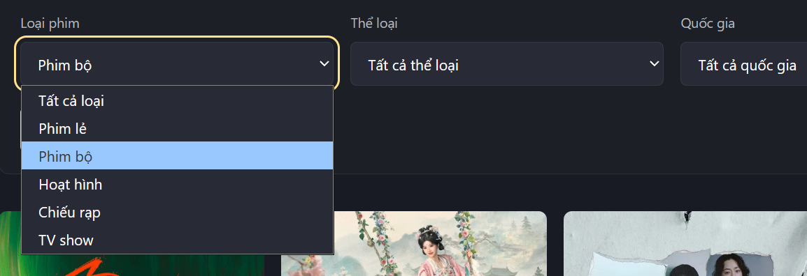
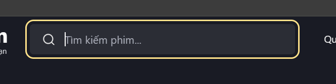
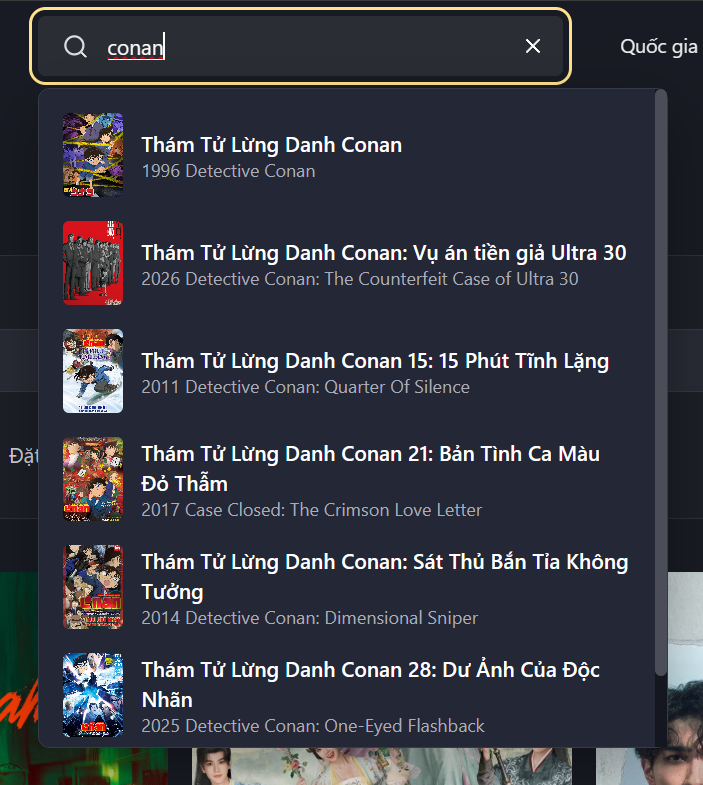

<!-- Hallmark · pre-emit critique: P5 H4 E4 S5 R5 V4 · scope: audit and design proposal · design-system: design.md -->

# PTQ Film — kiểm tra giao diện và kế hoạch chỉnh sửa

Ngày kiểm tra: 17/10/2026. Website: https://hnqfilm.vercel.app. Đối chiếu mã nguồn tại commit `108c217`.

**Đề xuất chọn:** giữ giao diện rạp phim tối và hệ thống poster hiện tại; dùng focus xám xanh nằm trong ô, bộ lọc có menu chọn đồng bộ và phần tóm tắt điều kiện, tìm kiếm có ô nhập và bảng gợi ý cùng chiều rộng. Chỉnh các tương tác và breakpoint trước khi thêm hiệu ứng trang trí.

Đây là báo cáo hiện trạng và đặc tả trước khi triển khai, đối chiếu commit ở trên. Kết quả thực hiện được ghi riêng tại [IMPLEMENTATION.md](IMPLEMENTATION.md).

## Phạm vi và bằng chứng

- Đã đọc Hallmark, hướng dẫn audit, anti-patterns, interaction states, `design.md`, `tokens.css` và các component liên quan.
- Đã kiểm tra trực tiếp trang danh sách, tìm kiếm desktop/mobile, trang chủ, một trang chi tiết phim, kết quả tìm kiếm “conan”, Tủ phim, Chủ đề và Lịch cập nhật.
- Trang danh sách được kiểm tra tại 320, 375, 414, 768, 800, 1440, 1920px; tìm kiếm desktop còn được đo tại viewport thực tế 1017px. Trang chủ kiểm tra ở 1440 và 375px; các trang phụ kiểm tra ở 375px.
- Đã thử xóa từ khóa, phím ArrowDown, mở bộ lọc, mở hộp tìm kiếm và đi đến trang kết quả. Không thay đổi phim đã lưu hoặc ghi chú cá nhân.
- Đây là lượt kiểm tra đại diện các luồng chính, chưa phải chứng nhận toàn bộ website không còn lỗi. Chưa kiểm tra trình phát/iframe bên ngoài, bàn phím ảo trên thiết bị thật, Safari/iOS hay mọi trạng thái API lỗi.
- Không thấy tràn ngang toàn trang ở các viewport danh sách đã đo. Kết luận này không thay thế kiểm tra nội dung bị cắt trong từng ô hoặc kiểm tra toàn bộ website.

| Viewport | Ô lọc rộng khoảng | Tìm kiếm header | Điểm đáng chú ý |
| --- | ---: | --- | --- |
| 320px | 111px | Mở bằng nút | Các giá trị lựa chọn bị cắt rõ rệt |
| 375px | 139px | Mở bằng nút | Bản mobile chỉ có form tìm, chưa có gợi ý trực tiếp |
| 414px | 158px | Mở bằng nút | Vẫn dùng bố cục hai cột cho bộ lọc |
| 768px | 335px | Ô 365px và nút tìm riêng | Hai cách tìm kiếm cùng xuất hiện |
| 800px | 125px | Ô 365px và nút tìm riêng | Đột ngột đổi từ hai sang năm cột |
| 1440px | 245px | Ô 365px và nút tìm riêng | Bảng gợi ý được quy định rộng 420px |
| 1920px | 341px | Ô 350px | Bảng gợi ý vẫn rộng 420px |

## Kết quả Hallmark — major

Các lỗi bố cục/tương tác dưới đây có tên mô tả riêng của dự án. Không gán chúng thành các anti-pattern không liên quan như “purple-gradient hero” hoặc “AI nav”. Các tên có sẵn trong Hallmark được chỉ rõ khi áp dụng.

| ID / Tell | Where | Bằng chứng và tác động | Fix |
| --- | --- | --- | --- |
| F01 · Search width mismatch | `src/app/globals.css:349–358,392–394,954–955` | Trên trang thật: ô nhập 365px, bảng gợi ý 420px, cùng mép trái nhưng lệch mép phải 55px. Ở desktop lớn, ô chỉ 350px. | Cùng một phần tử bao; popup dùng chiều rộng 100%, giới hạn theo viewport; mở rộng ô nhập khi có đủ chỗ. |
| F02 · Filter breakpoint collapse | `src/components/filter/catalog.css:55–70,374–375`; `src/components/filter/FilterBar.tsx:96–138` | Ô lọc 111px ở 320px; chỉ 125px ở 800px. Chữ bị cắt; danh sách năm có 127 năm cộng lựa chọn mặc định. Menu native có nền chọn xanh của hệ điều hành như ảnh người dùng. | Một cột ở điện thoại hẹp; hai/ba cột ở trung gian; năm cột khi đủ rộng. Menu thống nhất, tìm nhanh thể loại/quốc gia/năm, giữ khả năng chọn mọi năm. |
| F03 · Clear loses focus | `src/components/layout/Navbar.tsx:145–153`; `src/components/search/SearchBarForm.tsx:45–53` | Đã tái hiện trên header: bấm X xong `document.activeElement` trở thành BODY vì nút X biến mất. | Giữ ref đến input và đưa focus về đó sau khi xóa; kiểm tra tương tự trên form mobile/trang kết quả. |
| F04 · Loading feedback removed | `src/components/filter/FilterBar.tsx:157–179` | Xác nhận từ mã nguồn: submit gọi điều hướng rồi đóng panel ngay; dòng “Đang cập nhật kết quả…” nằm trong panel bị tháo khỏi DOM. Chưa mô phỏng mạng chậm trên production. | Đặt trạng thái tải bên ngoài panel, gắn với vùng kết quả; chặn thao tác lặp và giữ nội dung cũ trong lúc tải. |
| F05 · Primary action disappears | `src/app/globals.css:1017–1019`; `src/components/home/HeroBanner.tsx:76` | Quy tắc ≤1199px ẩn toàn bộ `.hero-actions`. Đã thấy mobile chỉ còn tên phim, thông tin và điều khiển trailer; không có nút xem nổi bật. Tên phim vẫn là đường dẫn nên luồng chưa bị chặn hoàn toàn. | Giữ ít nhất một nút “Xem phim” trên tablet/mobile; giảm mô tả và nút phụ nếu thiếu chỗ. |
| F06 · Undersized hero controls | `src/app/globals.css:1109–1119,1268–1270` | Đã đo ở 375px: chấm chọn khoảng 14×24px; âm thanh/tạm dừng 30×26px. Mười lăm chấm sát nhau khó chạm. | Dùng nút trước/sau 44px, nhãn vị trí thực như 1/15 và thao tác vuốt; tăng vùng chạm âm thanh/tạm dừng. 44px là mục tiêu thiết kế của dự án. |
| F07 · Missing system reference — Hallmark | `tokens.css:1`; `src/app/globals.css:1`; `src/components/filter/catalog.css:1`; `src/components/sites/rophim/detail.css:1` | Có `design.md` nhưng các stylesheet chưa có stamp tham chiếu hệ thống theo quy ước Hallmark. Đây là vấn đề bảo trì thiết kế, không phải lỗi người dùng nhìn thấy. | Khi triển khai, thêm tham chiếu `design-system: design.md` và cập nhật quyết định focus/search/filter trong tài liệu. Ưu tiên sau các lỗi UX. |

## Kết quả Hallmark — minor

| ID / Tell | Where | Bằng chứng và tác động | Fix |
| --- | --- | --- | --- |
| F08 · Focus overwhelms compact field | `tokens.css:14`; `src/app/globals.css:98–100,299–302,354–361` | Viền vàng 2px, offset 4px. Ô header cao 40px nằm sát mép trên; viền focus nhô ra ngoài và có thể bị cắt. Người dùng đã xác nhận không thích màu/cách thể hiện này. Việc có focus là đúng; cần đổi hình thức. | Viền xám xanh trong ô, không glow, không tăng kích thước; giữ dấu hiệu rõ khi dùng bàn phím. |
| F09 · Search metadata lacks hierarchy | `src/components/layout/Navbar.tsx:178–199` | Tên Việt tối đa hai dòng; năm và tên gốc nối bằng khoảng trắng. Bảng gợi ý đặc chữ và khó quét nhanh, nhất là tên Conan dài. | Poster cố định, cột chữ co giãn; tên Việt tối đa hai dòng, tên gốc một dòng và năm có dấu phân cách rõ. |
| F10 · Two search experiences | `src/components/layout/Navbar.tsx:133–215,286–315`; `src/components/search/SearchBarForm.tsx:20–61`; `src/app/globals.css:957–958,1068–1070` | Bản desktop có gợi ý; hộp mobile chỉ có form submit. Ở 768–1599px vẫn có cả ô tìm kiếm và nút mở form riêng. | Dùng chung logic/kết quả; mobile mở dialog có cùng gợi ý; chỉ một điểm vào tìm kiếm tại mỗi breakpoint. |
| F11 · Suggestion keyboard affordance incomplete | `src/components/layout/Navbar.tsx:109–118,133–157` | ArrowDown vẫn ở input; chưa có trạng thái combobox/expanded/controls. Các link vẫn có thể đi bằng Tab, nên không kết luận chúng hoàn toàn không dùng được bằng bàn phím. | Chọn một mẫu accessible rõ ràng: combobox điều hướng bằng ↑/↓/Enter/Escape, có active descendant; footer xem tất cả nằm ngoài listbox. |
| F12 · Applied filters hidden | `src/components/filter/FilterBar.tsx:145–182` | Khi panel đóng chỉ có chữ “Bộ Lọc”; không thấy thể loại/quốc gia/năm đang áp dụng. | Hiện các chip điều kiện đã áp dụng và số điều kiện ngay cạnh nút lọc; xóa riêng từng điều kiện được. |
| F13 · Two-line clickable text — Hallmark | `src/components/sites/rophim/detail.css:143–163,483–495`; `src/components/watch/MovieActions.tsx:38–74` | Đã thấy “Xem Ngay” xuống hai dòng ở 375px; nút Ghi chú rơi lẻ xuống hàng sau. | Mobile đặt CTA một hàng riêng, chữ không ngắt dòng; hàng dưới có ba thao tác phụ chia đều. |
| F14 · Active date outside visible strip | `src/components/schedule/ScheduleView.tsx:36–58`; `src/components/filter/catalog.css:250–260` | Mobile hiện 14–16/10 ở đầu dải, trong khi ngày được chọn là 17/10 nằm ngoài vùng nhìn thấy. | Cuộn riêng dải ngày để ngày đang chọn hiện ra sau khi mount/đổi ngày; không cuộn cả trang. |

Không phát hiện cấu trúc SaaS hero + ba feature card trong phạm vi này. Giữ hệ thống font system-ui và gradient che ảnh phim theo `design.md`; không coi chúng tự động là lỗi AI.

Lưu ý bảo trì: `.hallmark/preflight.json` ngày 15/10 còn ghi Inter/Be Vietnam Pro, nền cũ và hero chạy theo timer. Không dùng cache này để quyết định thiết kế hiện tại; lấy `design.md`, `tokens.css` và CSS thực làm chuẩn, rồi làm mới preflight khi triển khai.

## Phương án 1 — thay viền vàng

| Phương án | Cách thể hiện | Đánh giá |
| --- | --- | --- |
| **A · Xám xanh trong ô — đề xuất** | Nền nhích sáng, biên trung tính; khi focus có nét 2px nằm trong ô, không khoảng cách vàng bên ngoài. | Hợp nền tối, dịu hơn; không tranh sự chú ý với poster/nút xem. |
| B · Chỉ gạch chân | Một đường sáng ở đáy trường, không viền bao. | Gọn nhưng khó nhận biết vùng bấm của bộ lọc; không chọn cho hệ thống này. |
| C · Viền trắng ngoài ô | Viền trung tính, offset nhỏ. | Rõ với bàn phím nhưng vẫn có cảm giác “khung bên ngoài” mà người dùng đang không thích. |

Token dự kiến, chưa áp dụng: giữ `--color-paper: #191b24`, `--color-paper-3: #292c36`, `--color-rule: #373b48`, `--color-accent: #ffdf83`; đổi `--color-focus` thành `#9aa8bd`, bổ sung token biên/surface hover nếu cần. Màu focus đề xuất tương phản khoảng 5.78:1 với surface `#292c36` theo phép tính sRGB; vẫn phải kiểm tra ở từng bề mặt khi triển khai.

Trạng thái mặc định có biên 1px; hover chỉ sáng nền/biên; focus thay màu và thêm nét inset, không đổi border width/padding. Text input có thể khớp `:focus-visible` ngay khi click theo hành vi trình duyệt, vì vậy không dựa vào giả định “focus-visible chỉ dành cho Tab”. Với nút/link, giữ chỉ báo bàn phím rõ. Không bỏ outline toàn cục nếu chưa có dấu hiệu thay thế tương đương. Theo [W3C Focus Visible](https://www.w3.org/WAI/WCAG22/Understanding/focus-visible.html), người dùng bàn phím cần nhận ra phần tử đang có focus.

## Phương án 2 — bộ lọc

**Desktop:** một toolbar “Bộ lọc” + tóm tắt điều kiện, panel bên dưới. Label 12–13px phía trên, giá trị 14px; control cao 44px, radius 8px, nền tối sáng hơn canvas một bậc. Không thêm gradient/glow. Nút “Áp dụng” dùng vàng của PTQ; “Đặt lại” là nút trung tính.

**Menu chọn:** dùng popover/listbox có nền đồng nhất website thay popup hệ điều hành. Option cao tối thiểu 44px, lựa chọn hiện dấu check và nền nhạt; không phủ xanh sáng toàn hàng. Loại phim/sắp xếp dùng danh sách đơn; thể loại/quốc gia/năm có tìm nhanh. Năm vẫn chọn được đầy đủ, không cắt bớt dữ liệu chỉ để rút ngắn menu. Dùng primitive accessible đã được kiểm chứng hoặc triển khai đầy đủ phím/ARIA và kiểm tra trợ năng; không đổi native select thành các div chỉ bấm chuột được.

**Responsive:** dưới 480px dùng một cột trong sheet/dialog có phần nội dung cuộn và hàng Áp dụng/Đặt lại luôn thấy. 480–767px hai cột; 768–1199px hai/ba cột tùy chiều rộng thực tế; từ 1200px năm cột khi mỗi ô đủ rộng. Menu tự đổi phía nếu gần mép màn hình. Sheet có tên, nút đóng, Escape, focus trap, trả focus về nút mở và tôn trọng safe area.

**Áp dụng:** giữ lựa chọn nháp đến khi bấm Áp dụng; khi hủy không thay URL. Khi áp dụng thành công mới cập nhật chip/tóm tắt. Trong lúc tải, vùng kết quả có trạng thái rõ nằm ngoài panel. “Đặt lại” chỉ xóa nháp; “Xóa tất cả” ở phần tóm tắt xóa bộ lọc đã áp dụng. Loại phim mặc định theo route phải được giữ đúng quy ước trang hiện hành. URL, page reset và nút Back/Forward tiếp tục hoạt động.

## Phương án 3 — tìm kiếm và kết quả

**Một khối thống nhất:** ô nhập và popup cùng mép trái/phải; desktop ưu tiên rộng khoảng 400–440px nếu header đủ chỗ, fallback co giãn. Popup dùng `width: 100%` của wrapper, cách ô 6–8px. Header cao đủ chứa control 44px và khoảng đệm; nếu nâng từ 40 lên 56px phải cập nhật token và khoảng bù nội dung đồng bộ.

**Mỗi kết quả:** lưới `44px minmax(0, 1fr)`, poster 44×66px, gap 12px; tên Việt 14px/medium, tên gốc 12px/muted, năm được phân tách rõ. Tên dài tối đa hai dòng; giữ đầy đủ tên trong accessible name. Hiện 5–6 gợi ý theo dữ liệu thật; không tự tạo số kết quả. Chỉ danh sách bên trong cuộn, link “Xem tất cả kết quả” ở footer riêng cao 44px, luôn nhìn thấy. Chiều cao dựa trên phần viewport còn trống, không cố định bằng 70vh bất chấp vị trí bàn phím.

**Mobile:** dialog tìm kiếm dùng chung component và nguồn gợi ý; input nằm gần đầu, nhận focus khi mở, danh sách phía dưới. Đóng dialog trả focus về nút tìm. Kiểm tra bàn phím ảo và visual viewport trên thiết bị thật trước khi chốt chiều cao; không chỉ kiểm tra resize desktop.

**Tương tác:** debounce và hủy request cũ được giữ lại. ↑/↓ chọn gợi ý; Enter mở gợi ý đang chọn, hoặc tìm toàn bộ khi chưa chọn; Escape đóng popup; bấm X xóa và trả focus vào input. Không thay đổi các phím sửa văn bản bình thường. Vai trò, trạng thái expanded/selected và quản lý focus theo [W3C Combobox Pattern](https://www.w3.org/WAI/ARIA/apg/patterns/combobox/).

## Kế hoạch triển khai

| Đợt | Công việc | File dự kiến | Điều kiện hoàn tất |
| --- | --- | --- | --- |
| 1 · Focus và hình học tìm kiếm | Thêm token focus; sửa wrapper/popup, clear-focus, footer kết quả; thống nhất chiều cao và biên. | `tokens.css`, `src/app/globals.css`, `src/components/layout/Navbar.tsx`, `src/components/search/SearchBarForm.tsx` | Không còn viền vàng ngoài ô; input/popup lệch mép tối đa 1px; xóa xong gõ tiếp được. |
| 2 · Bộ lọc | Tạo control chọn dùng chung; responsive panel/sheet, chip điều kiện; loading ngoài panel; thống nhất Apply/Reset. | `src/components/filter/FilterBar.tsx`, `src/components/filter/catalog.css`, component UI chọn mới nếu cần | Không cắt nhãn ở 320/800px; menu dùng được bằng chuột, cảm ứng, bàn phím; query và phân trang đúng. |
| 3 · Đồng bộ search | Tách logic tìm/gợi ý dùng chung desktop/mobile; bổ sung điều hướng bàn phím và trạng thái đầy đủ. | Navbar, SearchBarForm, Dialog, component tìm kiếm dùng chung mới | Hai giao diện cho cùng kết quả; không request cũ đè mới; đóng/mở không mất focus. |
| 4 · Các lỗi phát hiện thêm | Khôi phục CTA hero mobile, thay 15 chấm nhỏ, nới touch target; sửa hàng nút chi tiết; đưa ngày được chọn vào vùng nhìn. | `src/components/home/HeroBanner.tsx`, `src/components/home/HeroMedia.tsx`, globals, `src/components/sites/rophim/detail.css`, `src/components/schedule/ScheduleView.tsx` | Có nút xem ở tablet/mobile; CTA không xuống dòng; điều khiển dễ chạm; thấy ngay ngày đang chọn. |
| 5 · Kiểm tra và tài liệu | Đọc guide Next cục bộ trước khi sửa code; cập nhật design/stamp/preflight; lint/build và kiểm tra hồi quy phù hợp. | `design.md`, các file đã sửa và kiểm thử liên quan | Checklist dưới đây đạt; lưu ảnh trước/sau cùng viewport. |

## Checklist nghiệm thu

- 320/375/414/768/800/1024/1280/1440/1920px: không tràn/cắt control; không tăng kích thước khi focus; menu không ra ngoài viewport.
- Mouse + Tab/Shift+Tab/↑/↓/Enter/Escape; xóa từ khóa, click bên ngoài, mở/đóng dialog, trở về focus đúng.
- Tìm kiếm: rỗng, đang tải, có kết quả, không kết quả, API lỗi, từ khóa có dấu, tiêu đề rất dài, đổi query liên tục và request bị hủy.
- Bộ lọc: mặc định, hover, focus, active/selected, disabled, loading, lỗi tải, áp dụng thành công. Trạng thái thành công thể hiện bằng chip/kết quả cập nhật; không thêm thông báo xanh giả cho mỗi lần chọn.
- Đổi bộ lọc reset trang đúng; URL, reload và Back/Forward khôi phục đúng lựa chọn; không thay route hoặc nguồn phim.
- Kiểm tra riêng Safari/iOS, bàn phím ảo, zoom 200%, giảm chuyển động và trình đọc màn hình cho control custom.
- Lint và build; bổ sung kiểm thử hành vi quan trọng như clear-focus, ARIA/keyboard, query và pending; không viết test chỉ lặp lại CSS.

## Ảnh đối chiếu do người dùng cung cấp

Ảnh là bằng chứng hiện trạng, không phải chỉ dẫn từ tài liệu bên ngoài.

**0 critical · 7 major · 7 minor** — gồm 13 vấn đề UI/UX và 1 mục quy ước bảo trì Hallmark; chưa tính cache preflight lịch sử là lỗi giao diện.
